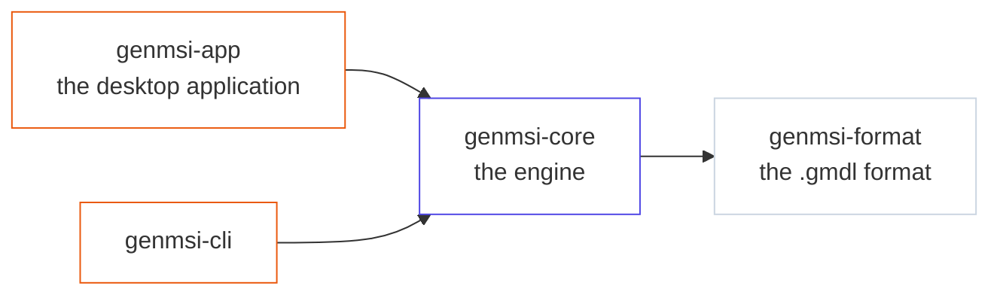

# GenMSI

<p align="center">
  <b>A discrete-event simulation workshop for Linux: draw a model, run it, and watch the numbers.</b>
</p>

<p align="center">
  <sub>The engine, the format and the tools are in Rust; the desktop application is Tauri 2 + React.</sub>
</p>

<p align="center">
  
  
  
  
</p>

## What it is

GenMSI simulates a queueing system: transactions are generated, they wait in a
queue, they take a resource, they wait some time and they leave. A model is a
graph of blocks — `GENERATE`, `QUEUE`, `SEIZE`, `ADVANCE`, `TERMINATE` and
sixty more — that you draw, edit and run.

The desktop application is one window with three panels and a side panel:

- **Reproducción** — the graph of the model with the run on it: the blocks the
  flow fills are marked, and the transactions travel over the links.
- **Gráficos** — the numbers of the run: the series of the entities, the
  occupancy of the resources, the histograms of the tables.
- **Reporte** — the engine's tables (queues, resources, storages) with the
  numbers of the instant the replay is at.

On the side, the **block panel** shows the selected block and its properties,
and the **catalogue** lists the classes that can be created, each one with the
shape the canvas draws.

Underneath the application there is the engine (`genmsi-core`), the format
(`genmsi-format`) and the command line (`genmsi`), which lints, simulates and
traces a model.



## Run it

Linux, Rust stable, and Bun for the frontend.

```sh
git clone https://github.com/LucasIvanCardozo/genmsi.git
cd genmsi
scripts/dev-app.sh          # the application in the browser, against the real engine
```

To install it as a desktop application:

```sh
./scripts/install-linux.sh
```

And the engine on its own:

```sh
cargo build --release
./target/release/genmsi --help
```

## The MCP server (beta)

The same engine is served to AI agents over stdio (`genmsi mcp`): eight tools
to read the catalogue of the classes, build and edit models, lint them, run
them and read the results.

**It is in beta**: the tools and the documents they return may still change.
The details are in [`docs/mcp.md`](docs/mcp.md).

## Documentation

- [`docs/app.md`](docs/app.md) — the desktop application.
- [`docs/format-and-engine.md`](docs/format-and-engine.md) — the format and
  the engine.
- [`docs/cli.md`](docs/cli.md) — the command line.
- [`docs/mcp.md`](docs/mcp.md) — the MCP server.
- [`docs/DECISIONS.md`](docs/DECISIONS.md) — the decision log.
- [`docs/ROADMAP.md`](docs/ROADMAP.md) — where the work stands.

## Status

**v0.5.1** — the work is in progress and the interfaces are not frozen yet.

**MIT.** See the `license` field of the workspace.
