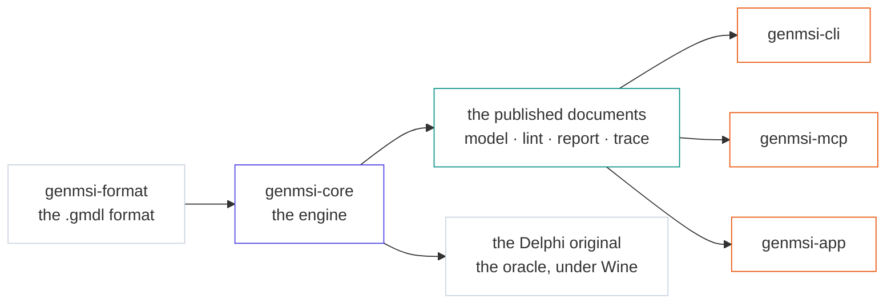

# GenMSI

<p align="center">
  <b>A native Linux reimplementation of the GenMSI simulation workshop — the engine, an MCP server for AI agents, and a desktop app.</b>
</p>

<p align="center">
  <sub>Semantic parity with the Delphi original, verified model by model.</sub>
</p>

<p align="center">
  
  
  
  
  
</p>

## What it is

| The engine | The MCP server | The desktop app |
|---|---|---|
| **`genmsi-format` + `genmsi-core`** — the format (`.gmdl`, 66 block classes) and the engine: a seeded scheduler, expressions, statistics, traces and reports. The engine **publishes** the documents every client reads; nobody computes a figure of its own. | **`genmsi mcp`** — the same engine over stdio, with eight tools: read the catalogue, build and edit models, lint them, run them, read the results. An agent that has never seen GPSS writes a model in a dozen calls. | **`genmsi-app`** — Tauri 2 + React: a node editor with real undo, a live monitor, and the reports and the charts of the engine, over the same engine. |

Five crates, one simulation core. The CLI, the MCP server and the app are thin
layers over it.

## Try it in 60 seconds

Linux, and Rust stable (the 2024 edition). The desktop app also needs Bun; the
engine does not.

```sh
git clone https://github.com/LucasIvanCardozo/genmsi.git
cd genmsi
cargo build --release
./target/release/genmsi simulate --seed 42 fixtures/models/ejercicio_1__ejercicio_1.gmdl
```

That prints the GPSS report of the model — the same tables the original Delphi
workshop prints, and exactly the output below. To install the app, the CLI and
the MCP server instead:

```sh
./scripts/install-linux.sh --with-mcp
```

## The demo

**An agent driving the model.** Four calls, and the model exists:

```
catalogue(classes=["Generate", "Queue", "Terminate"])         # the vocabulary
apply_edit(path, [addBlock, addBlock, connect, setProperty])  # the model
lint(path)                # does it compile? what did the engine find?
simulate(path, seed)      # the report
```

> A cold agent — no documentation in the prompt, no XML written by hand — built
> a 35-block model in **12 MCP calls**
> ([`odd/tasks/medida3/notas.md`](odd/tasks/medida3/notas.md)).

**And the engine answering.** The same command with the seed pinned, so the
run is reproducible — this is its real output:

```console
$ genmsi simulate --seed 42 fixtures/models/ejercicio_1__ejercicio_1.gmdl
                             Reporte MicroVisualSIS

 START_TIME    END_TIME     BLOCKS    FACILITIES    STORAGES
        0         3600        11           1            0

 LINE    ENTRY CURRENT RETRY            LOC  BLOCK_TYPE                                 
         COUNT   COUNT   
    1       62       1     0              1  GENERATE        60,30                      
    2       61       0     0      A_Advance  ADVANCE         10,5                       
    3       61       5     0  A_FacilityUse  QUEUE           Cola                       
    4       56       0     0              4  SEIZE           Recurso                    
    5       56       0     0              5  DEPART          Cola                       
    6       56       1     0              6  ADVANCE         65,25                      
    7       55       0     0              7  RELEASE         Recurso                    
    8       55       0     0     A_Advance1  ADVANCE         11,7                       
    9       55       0     0    A_Terminate  TERMINATE                                  
   10        2       1     0             10  GENERATE        3600                       
   11        1       0     0             11  TERMINATE       1                          

FACILITY       ENTRIES  UTIL.  AVE_TIME  AVAILABLE  OWNER PEND INTER RETRY DELAY
  RECURSO          56   0,987   63,464       1        56    0     0     0     5

QUEUE            MAX  CONT. ENTRIES ENTRIES(0) AVE.CONT. AVE.TIME AVE.(-0) RETRY
  COLA             6     5      61         1     3,249    191,770  194,967    0

FEC_XACT_NUMBER    PRI      BDT    CURRENT   NEXT   PARAMETER   VALUE
            63      0       3614        1       1
            56      0       3618        6       7
            64      0       7200       10      10
```

## Why the numbers hold

GenMSI is a reimplementation, so *it runs* is not the question: it has to answer
the same questions as the Delphi original. Every model is run under Wine
against the original and compared metric by metric — **20 models, 83–100% of
the metrics matched**:

| Model | Metrics | Match |
|---|---:|---|
| Problema 1__semaforo-1 | 132/132 | `██████████ 100%` |
| TP5__burgerShop | 65/65 | `██████████ 100%` |
| TP7__Clase 7_1_Link_Unlink | 9/9 | `██████████ 100%` |
| TP7__Clase 7_2_ProductorConsumidor | 13/13 | `██████████ 100%` |
| TP7__Clase 7_3_Cadete | 13/13 | `██████████ 100%` |
| ejercicio_1__ejercicio_1 | 9/9 | `██████████ 100%` |
| ejercicio_2__ejercicio_2 | 11/11 | `██████████ 100%` |
| entregaComida__entregaComida | 10/10 | `██████████ 100%` |
| TP2__problema1 | 56/57 | `█████████▉ 98%` |
| TP8__mecanicos | 114/116 | `█████████▉ 98%` |
| TP10__tp10 | 62/64 | `█████████▊ 97%` |
| monorriel__monorriel | 52/55 | `█████████▋ 95%` |
| TP4__supermercado | 61/65 | `█████████▌ 94%` |
| TP6__Clase 6_3_JefeEducado | 15/16 | `█████████▌ 94%` |
| TP3__aeropuerto | 82/91 | `█████████▏ 90%` |
| TP6__Clase 6_2_UltimoCliente | 17/19 | `█████████▏ 89%` |
| ejercicio_3__ejercicio_3 | 18/21 | `████████▋▏ 86%` |
| Parcial 6-11-23__Veron - Parcial | 128/150 | `████████▋▏ 85%` |
| TP6__Clase 6_1_PuertaBanco | 11/13 | `████████▋▏ 85%` |
| ejercicio_4__ejercicio_4 | 24/29 | `████████▍▏ 83%` |

The rule is statistical, not bit-exact: a metric matches when its relative
error is within 20% (counts) or 35% (times and occupancies), or when the
baseline lies inside the 95% confidence interval of our replication mean. The
model-by-model comparison is in
[`docs/oracle-comparison.md`](docs/oracle-comparison.md); the harness that runs
the original under Wine is in
[`docs/oracle-wine.md`](docs/oracle-wine.md).

## One engine, four clients

The engine owns the simulation and publishes the documents; the CLI, the MCP
server and the app read them. That is why a number never changes between the
three: there is only one place where it is computed.



## The MCP server

One stdio process — the **same binary** as the CLI (`genmsi mcp`), the same
engine, the same documents. An agent and a script read the same thing.

| Tool | What it does |
|---|---|
| `catalogue` | Which block classes exist, what each one does, its ports, its properties and the XML of a block of it. |
| `apply_edit` | Adds, edits and connects blocks: a batch of the engine's own editing commands, applied atomically. |
| `lint` | Loads, validates and compiles a model and reports what it found. |
| `simulate` | Runs the model once and returns its GPSS report. |
| `get_trace` | Runs the model with the event trace on, filtered by class, block, transaction or time window. |
| `explain_model` | Describes the model: its blocks, its properties by name, the links that wire them, and the GPSS each block compiles to. |
| `save_model` | Writes a model the agent wrote, after checking that it compiles. |
| `app_state` | Which model the desktop app has open, so nobody has to guess where to write. |

Every model is taken as a `path` (a `.gmdl` file) or as a `model` (the document
as text). A failure names its class and the block that caused it, with the line
and the column, so an agent can fix its own model.

The **procedure** — how a model is written, which entities it has to declare,
what the expression language is — lives in the agent's guide,
[`skill/genmsi-modeling/SKILL.md`](skill/genmsi-modeling/SKILL.md). It is
installed with the product: `skill/` is a skills root, and copying it into
`~/.agents/skills/` is the whole installation.

<details>
<summary><b>Two things that bite</b></summary>

**The working directory.** The server inherits the directory the client
launches it in, and a relative `path` is resolved against it: the same call
works in one client and fails in another. Pin it when the client can
(`pi mcp add genmsi --cwd /path/to/Genmsi -- …`), and use **absolute paths** in
the calls — `app_state` already returns one.

**The guide is a file, not the protocol.** The catalogue, the tool descriptions
and the published schema travel in the protocol, so an agent can build a model
with the MCP alone. The procedure does not: it is installed with the product.

</details>

The server is the same everywhere; what changes is the file each client reads
and the key it uses — `mcpServers` for Pi, Claude Desktop, Cursor and Windsurf,
`servers` for VS Code, `context_servers` for Zed. The six configurations are
in [`docs/mcp.md`](docs/mcp.md).

## Documentation

| Document | What it holds |
|---|---|
| [`docs/DECISIONS.md`](docs/DECISIONS.md) | The decision log: why the engine owns the geometry, why the documents are versioned, what the MCP's verb is. |
| [`docs/format-and-engine.md`](docs/format-and-engine.md) | The `.gmdl` format and the semantics of the engine. |
| [`docs/cli.md`](docs/cli.md) | The CLI and the documents it prints. |
| [`docs/mcp.md`](docs/mcp.md) | The MCP server: the tools, the documents, the errors, the client configurations. |
| [`docs/mcp-transcript.md`](docs/mcp-transcript.md) | An agent building a model through the server, end to end. |
| [`docs/app.md`](docs/app.md) | The desktop application. |
| [`docs/oracle-comparison.md`](docs/oracle-comparison.md) | The comparison against the original, model by model. |
| [`docs/oracle-wine.md`](docs/oracle-wine.md) | How the original is run under Wine to produce that comparison. |
| [`docs/ROADMAP.md`](docs/ROADMAP.md) | The phases of the work and where each one stands. |

## Status & license

**v0.5.1** — the work is in phases 0 to 4
([roadmap](docs/ROADMAP.md)); the documents are versioned, but the API is not
frozen yet.

**Development** — `cargo test --workspace` for the engine, the format, the CLI
and the MCP; `bun run test` for the app. The rules of the house are in
[`docs/DECISIONS.md`](docs/DECISIONS.md).

**MIT.** The original Delphi application is not part of this code. It is kept
in `Genmsi_20230711/` because it is the oracle: the harness in
`scripts/wine-oracle/` runs it under Wine and compares its numbers with ours.
